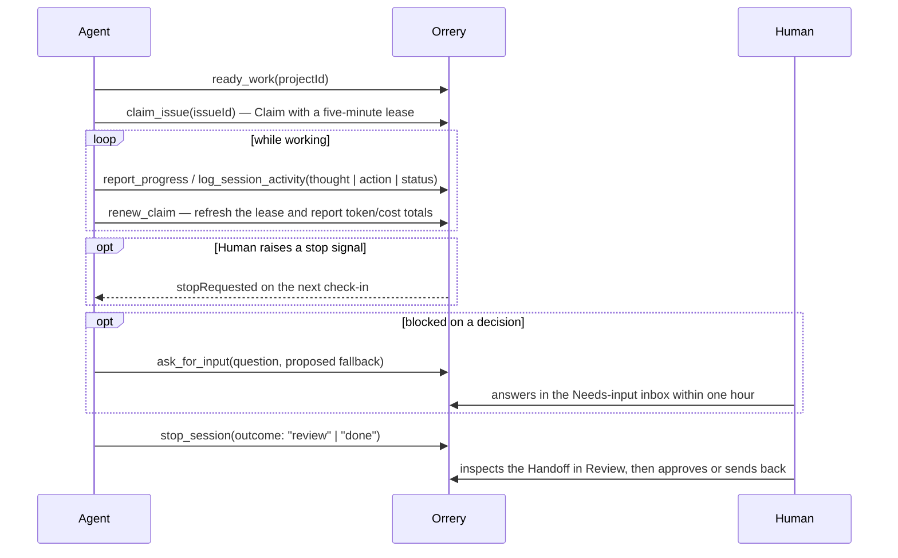

<p align="center">
  <picture>
    <source media="(prefers-color-scheme: dark)" srcset="assets/orrery-mark-dark.svg">
    
  </picture>
</p>

<h1 align="center">Orrery</h1>

<p align="center">
  <strong>Self-hosted project management for teams of humans <em>and</em> AI agents.</strong><br>
  One board for everyone doing the work — with real claims, live steering, and an MCP endpoint your agents pull from.
</p>

<p align="center">
  <a href="#roadmap"></a>
  
  <a href="LICENSE"></a>
</p>

<p align="center">
  <a href="#features">Features</a> ·
  <a href="#quick-start">Quick Start</a> ·
  <a href="docs/guides/install.md">Guides</a> ·
  <a href="#how-it-works">How It Works</a> ·
  <a href="#mcp-tools">MCP Tools</a> ·
  <a href="#connect-claude-code--codex">Connect Agents</a> ·
  <a href="#webhooks--notifications">Webhooks</a> ·
  <a href="#roadmap">Roadmap</a> ·
  <a href="#contributing">Contributing</a>
</p>

> **Status: MVP complete.** M0–M4 and M6 (in-app notifications, workspace-scoped outgoing webhooks,
> operator/agent guides, and GHCR GitHub Releases) are complete and runnable today from the
> published image with `docker compose pull && docker compose up -d`. See the
> [roadmap](#roadmap) and the [install guide](docs/guides/install.md).

---

## Why Orrery

Local coding agents — Claude Code, Codex, Cursor — do real work in terminals, off the board. Their
humans can't see which issue an agent is on, two agents can pick up the same task, and a blocked
agent can sit silent for hours waiting for an answer.

Orrery puts Humans and Agents on one board and gives them a protocol for working together:

- **Pull-based MCP + REST.** Agents run on teammates' machines and pull work over HTTP with a
  workspace-scoped API key. No inbound agent webhooks, no open ports on developer laptops, no
  orchestration daemon — it works behind NAT.
- **Atomic five-minute Claim leases.** `claim_issue` reserves an issue for one Work session; a
  laptop that crashes simply releases the Claim when the lease expires. No two agents duplicate an
  issue.
- **Live steering.** A Human can raise a stop signal that the agent sees on its next check-in.
  Ephemeral `thought` / `action` / `status` entries feed a sidecar inspector, and a blocked agent
  opens a Needs-input question with a proposed fallback; after one hour the project's policy either
  pauses the issue for a Human or applies the authorized fallback.
- **Security and correctness by construction.** API keys are scoped to one Workspace and capped by
  the Human owner's live permissions, every change carries an actor in the audit trail, and 36
  state-machine models are formally verified with `formal-verify-orrery`.

Orrery **tracks** agents; it does not run them. Agents keep working wherever your team already uses
them and connect over [MCP](https://modelcontextprotocol.io).

> An **orrery** is a model of the solar system that shows every planet on its own orbit, moving in
> one system. Here the planets are your issues, your people and your agents.

## Features

- **Board, Issues & Project Knowledge.** Six-column Kanban board (`Backlog`, `Todo`, `In progress`,
  `Review`, `Done`, `Cancelled`) with drag-and-drop, instant search, status/assignee/priority/label
  filters, blocker indicators, and a sidecar session preview drawer. Issues carry `KEY-N`
  identifiers, priority levels, color-coded project labels (with preset swatches and live preview),
  one-level subtasks with close-guard warnings, acyclic `blocked_by` dependencies, structured
  PR/commit/doc links, GitHub-flavored Markdown with `#issue` auto-linking and Light/Dark Mermaid
  diagrams, structured project knowledge, and human-only Trash with 30-day restore.
- **Agents, Runs & Harness Telemetry.** Register agents with workspace-scoped API keys (expiry,
  rotation, revocation), monitor live active work sessions and raise stop signals, and inspect
  structured Run histories with recognized harness brand logos (Claude Code, Codex, OpenAI, Cursor,
  OpenCode, Gemini, Grok, GitHub Copilot, Windsurf, Cline), model-change tracking, child worker
  trees, cumulative token/cost telemetry, and an ephemeral sidecar activity inspector (`key_value`,
  `table`, `checklist`, `test_results`, and JSON blocks).
- **Cross-Workspace Focus.** **My work** (`/my-work`) pulls active sessions, review handoffs, and
  assigned issues across every workspace; the **Needs-input Inbox** (`/inbox`) surfaces blocked
  agent questions with one-hour fallback policies; and **Notifications** (`/notifications` plus a
  live sidebar unread badge) track review handoffs, questions, mentions, and lease/deadline events.
- **Workspace-Scoped Outgoing Webhooks.** Owner-managed webhooks with project/event filtering,
  transactional Postgres outbox retries, HMAC-SHA256 signing, a default-deny DNS-pinned SSRF guard,
  auto-disable circuit breaking, and a live-polling delivery log drawer with one-click test events.
- **Multi-Workspace Identity, Access & Audit.** Personal and Shared workspaces, delegated
  permissions via a slide-out Permissions drawer, per-project `read` / `contribute` / `manage`
  grants, project transfers between workspaces, email invitations with delivery tracking, full
  installation/workspace/project audit history, ownership recovery, and encrypted-at-rest SMTP
  settings (`ORRERY_ENCRYPTION_KEY`).
- **Responsive Astryx UI.** Built on the Astryx Design System (`@astryxdesign/core`) with Light,
  Dark, and System themes, accessible dialogs and drawers, and mobile-responsive layouts with
  horizontal-scrolling data tables.

## Quick Start

Self-hosted in one command. You need Docker with the Compose plugin.

```sh
cp .env.example .env
```

In `.env`, set:

- `POSTGRES_PASSWORD` — letters and digits only (it is embedded in `DATABASE_URL`).
- `BOOTSTRAP_SECRET` — at least 32 characters; used once at `/setup`, then remove it from `.env`.
- `ORRERY_ENCRYPTION_KEY` — generate with `openssl rand -base64 32`; without it an SMTP password
  cannot be saved.

```sh
openssl rand -base64 32
docker compose pull
docker compose up -d
```

Use `docker compose up -d --build` instead of `pull` + `up` if you want to build from this checkout.

Open <http://localhost:8080/setup>, create the first administrator with the bootstrap secret, then
remove `BOOTSTRAP_SECRET` from `.env` — setup stays closed forever. The app is then at
<http://localhost:8080>.

For HTTPS on a public domain, set `ORRERY_DOMAIN` and `PUBLIC_URL` in `.env` and add `--profile tls`
(`docker compose --profile tls pull && docker compose --profile tls up -d`). Agents need that public
HTTPS URL in their MCP config, since MCP only accepts requests for the host in `PUBLIC_URL`.

The full [install and upgrade guide](docs/guides/install.md) covers the environment variables,
Caddy HTTPS, image tags and upgrades. Take a backup before upgrading using
[Backup and restore](docs/guides/backup-and-restore.md).

### Local development

```sh
pnpm install
docker compose up -d postgres
pnpm dev
```

The server reloads on <http://localhost:8080> and the Vite web app runs on <http://localhost:5173>.
Run `pnpm check` before committing; `pnpm gen` regenerates the contract and `pnpm db:generate`
generates migrations.

## How It Works

Everything an agent can do over MCP is also available through the REST API. Agents pull work from
one static `/mcp` endpoint — pull-based behind NAT, with nothing to deploy on the laptop beyond the
harness itself; Humans use the web UI or REST.

### How an agent works an issue



`reacquire_issue` carries progress across an interruption. Six issue states — `backlog`, `todo`,
`in_progress`, `review`, `done`, `cancelled` — and `KEY-N` identifiers keep the board predictable.

## MCP Tools

All 39 tools are defined in [`contract/mcp-tools.json`](contract/mcp-tools.json) (generated from
[`packages/contract/src/mcp-tools.ts`](packages/contract/src/mcp-tools.ts)) and served at `/mcp`.
The same operations are available over REST.

### Context & Projects

| Tool | What it does |
| --- | --- |
| `list_projects` / `get_project` | List projects in the API key's scope; read one project |
| `list_knowledge` / `get_knowledge` | List and read a project's structured knowledge entries |
| `create_knowledge` / `update_knowledge` | Write project knowledge (Contribute access) |

### Issues & Dependencies

| Tool | What it does |
| --- | --- |
| `list_issues` / `get_issue` | List issues (with label/parent filters); read one with labels, subtasks and PR/commit/doc links |
| `create_issue` / `update_issue` | Create and edit issues, one-level subtasks (`parentIssueId`), status, priority, float `sortOrder`, assignee |
| `list_labels` / `create_label` / `update_label` / `delete_label` | Manage project-scoped labels |
| `attach_issue_label` / `detach_issue_label` | Attach or detach labels on an issue |
| `add_blocked_by` / `remove_blocked_by` | Add or remove acyclic `blocked_by` edges |
| `list_blocked_by` / `list_blocking` | Read an issue's prerequisites and dependants |
| `list_comments` / `create_comment` | Read and write issue comments |
| `add_issue_link` / `remove_issue_link` | Attach or remove PR, commit, doc and web links |

### Work Sessions & Telemetry

| Tool | What it does |
| --- | --- |
| `ready_work` | Ready `todo` issues with no live Claim, no unmet blocker, not Needs input |
| `claim_issue` / `renew_claim` | Take a five-minute Claim; refresh the lease and report token/cost totals |
| `report_progress` / `log_session_activity` | Durable progress; ephemeral thought/action/status entries with v1 structured blocks |
| `get_work_session` / `list_work_sessions` | Inspect the latest or all Work sessions on an issue |
| `resume_work_session` / `reacquire_issue` | Read-only disposition after a resume; reacquire an expired Claim with progress carried forward |
| `stop_session` | Complete a session: `outcome: review` (Handoff), `done`, or `released` |
| `list_session_activities` | Read the ephemeral sidecar timeline |
| `list_activity` | Project activity feed, including which actor did what |

### Needs-Input Inbox

| Tool | What it does |
| --- | --- |
| `ask_for_input` | Open a one-hour blocking question with a proposed fallback |
| `list_issue_questions` | List questions and resolutions, including `paused` / `fallback_used` |

### Runs & Harness Attribution

| Tool | What it does |
| --- | --- |
| `orrery_run_checkin` | Check in a Harness conversation by `runId` or `(harness, nativeSessionId)`; report model and harness version |

> Today's `*_knowledge` tools cover lightweight project-scoped Markdown knowledge. Post-MVP
> agent-memory upgrades — Postgres full-text search (`search_knowledge`), doc↔issue linking, and
> delete/trash — are proposed in [#140](https://github.com/forge-orbit/orrery/issues/140).

## Connect Claude Code / Codex

The short version is below. The one-page [Connect an agent](docs/guides/connect-agent.md) quickstart
also covers Cursor and the raw `/mcp` fallback.

Create an Agent in Orrery, issue it a workspace-scoped API key, and export your server URL and key
in the shell environment your harness inherits:

```sh
export ORRERY_URL="https://orrery.example.com"
export ORRERY_API_KEY="<API key>"
```

Install the official plugin from
[`forge-orbit/orrery-integrations`](https://github.com/forge-orbit/orrery-integrations) to wire both
the static `/mcp` endpoint and automatic run-lifecycle reporting hooks in one step:

- **Claude Code:**
  ```text
  /plugin marketplace add forge-orbit/orrery-integrations
  /plugin install orrery@forge-orbit
  ```
- **Codex CLI:**
  ```sh
  codex plugin marketplace add forge-orbit/orrery-integrations
  codex plugin add orrery@forge-orbit
  ```
  Review and trust the plugin hooks in `/hooks`.

If you only want the static `/mcp` tools without run-reporting hooks:

```sh
claude mcp add --transport http orrery https://orrery.example.com/mcp \
  --header "Authorization: Bearer <API key>"
```

For full setup details, manual script wiring, privacy guarantees, and the verified gates, see:

- [Orrery Integrations (`forge-orbit/orrery-integrations`)](https://github.com/forge-orbit/orrery-integrations)
- [Claude Code run reporting](docs/guides/claude-code-runs.md)
- [Codex CLI run reporting](docs/guides/codex-run-reporting.md)

## Webhooks & Notifications

Orrery keeps both humans and external integrations in sync as work moves across the board:

- **In-app notifications & proactive sweeper.** A background sweeper resolves expired Claims and
  one-hour Needs-input deadlines without waiting for a read, surfacing updates in `/notifications`
  and the live sidebar unread badge.
- **Workspace-scoped outgoing webhooks.** Workspace owners can register up to 20 webhook endpoints
  subscribed to any combination of Orrery's 31 project activity events (or all events) across all or
  selected projects. Deliveries are enqueued in a transactional Postgres outbox, retried with
  exponential backoff across up to 5 attempts, protected by a default-deny DNS-pinned SSRF guard
  (IPv4 & IPv6), and automatically disabled after 10 consecutive delivery failures.

Every webhook request is signed with the endpoint's one-time `whsec_` secret (encrypted at rest and
rotatable from the UI) and carries four headers:

| Header | Value |
| --- | --- |
| `X-Orrery-Delivery` | Unique delivery ID |
| `X-Orrery-Event` | Activity event name (e.g. `issue_review_handoff`) or `webhook.test` |
| `X-Orrery-Timestamp` | Unix timestamp (seconds) |
| `X-Orrery-Signature-256` | `sha256=<hex>` HMAC-SHA256 of `${timestamp}.${rawBody}` using the `whsec_` secret |

See [ADR-0007](docs/adr/0007-outgoing-webhooks-outbox-and-security.md) and
[Release polish design](docs/design/release-polish.md) for payload structure, SSRF rules, and
delivery guarantees.

## Architecture & Reliability

- **Postgres constraints are the source of truth.** The Drizzle schema and generated migrations
  enforce one active Work session per issue, Claim exclusivity, acyclic dependencies and the
  six-state workflow in the database, not just in application code.
- **RFC 9457 Problem Details.** Errors are `application/problem+json` with a stable `code`, built
  through one platform helper; successes return the resource itself.
- **Generated contracts.** OpenAPI 3.1 (`contract/openapi.json` — 123 REST operations across 100
  endpoints) and MCP tool JSON Schemas (`contract/mcp-tools.json` — 39 tools) are generated from Zod
  schemas in `packages/contract/`; a mounted route missing from the contract fails CI.
- **Formal verification & black-box E2E.** `formal-verify-orrery` exhaustively checks 36
  state-machine models (`M1`–`M35`) across claims, leases, invitations, API keys, runs, inbox
  questions, ownership transfers, sweeper notifications, and outgoing webhooks, complemented by 110+
  Playwright and Vitest E2E tests run against the production Docker image in CI.
- **Stack.** TypeScript on Node 26 · Hono with `@hono/zod-openapi` · Drizzle ORM on PostgreSQL 18 ·
  React, Vite, TanStack Router, TanStack Query and the Astryx Design System (`@astryxdesign/core`) ·
  Model Context Protocol HTTP server.

## Roadmap

Milestones are tracked as GitHub epics. The MVP (M0–M4 and M6) is complete and live today; the
Obsidian-like Shared vault (M5, [#6](https://github.com/forge-orbit/orrery/issues/6)) was dropped
as not planned to keep Orrery focused on agent-first project management.

- [x] [#1](https://github.com/forge-orbit/orrery/issues/1) **M0 — Foundation.** Docker Compose, CI,
  first-run bootstrap, encrypted SMTP settings.
- [x] [#2](https://github.com/forge-orbit/orrery/issues/2) **M1 — Auth, workspaces & agent
  identities.** Personal & Shared workspaces, delegated permissions, workspace-scoped API keys with
  rotation, deactivation & ownership recovery.
- [x] [#3](https://github.com/forge-orbit/orrery/issues/3) **M2 — Projects and issues.** Six-state
  workflow, `KEY-N` identifiers, priority & float board ordering, project-scoped labels, one-level
  subtasks, acyclic `blocked_by` dependencies, structured PR/commit links, comments, project
  knowledge, and human-only Trash with 30-day restore.
- [x] [#4](https://github.com/forge-orbit/orrery/issues/4) **M3 — Agent API and sessions.** MCP +
  REST parity (39 tools), five-minute atomic Claim leases, resume/reacquire, human stop signal,
  ephemeral session activities + v1 structured blocks, cumulative token/cost telemetry, and
  Needs-input inbox with one-hour fallback policies.
- [x] [#5](https://github.com/forge-orbit/orrery/issues/5) **M4 — Board, agents panel & needs-input
  inbox.** Six-column board, labels/subtasks/trash, rich sidecar inspector, and the cross-workspace
  My work view (`GET /api/my-work`).
- [ ] ~~[#6](https://github.com/forge-orbit/orrery/issues/6) **M5 — Shared vault.**~~ *Dropped (not
  planned) — replaced by lightweight post-MVP agent-memory upgrades in
  [#140](https://github.com/forge-orbit/orrery/issues/140).*
- [x] [#7](https://github.com/forge-orbit/orrery/issues/7) **M6 — Release polish.** Proactive expiry
  sweeper, in-app notifications (`/notifications` + unread badge), workspace-scoped outgoing
  webhooks with transactional outbox, HMAC-SHA256 signing & SSRF guard, operator/agent guides
  ([install](docs/guides/install.md), [backup/restore](docs/guides/backup-and-restore.md),
  [connect an agent](docs/guides/connect-agent.md)), and GHCR GitHub Releases.

Looking further ahead (post-MVP proposals):
[#140](https://github.com/forge-orbit/orrery/issues/140) agent-memory upgrades for project
knowledge (FTS search, doc↔issue linking, delete/trash),
[#15](https://github.com/forge-orbit/orrery/issues/15) agent-customizable UI (remaining rich blocks,
slots, panels, views), and [#14](https://github.com/forge-orbit/orrery/issues/14) plugin system.

## Contributing

The product code is here and the discussions are still open. Start with [`AGENTS.md`](AGENTS.md) for
the stack, commands and conventions, and the [docs index](docs/README.md) for guides and design
decisions. Plans are agreed in issues labeled
[`need discussion`](https://github.com/forge-orbit/orrery/labels/need%20discussion) before features
are built; the [MVP overview](https://github.com/forge-orbit/orrery/issues/8) gives the big picture.

## License

GNU Affero General Public License v3.0 (`AGPL-3.0-only`), with attribution notice preservation under
Section 7(b). See [LICENSE](LICENSE) and [NOTICE](NOTICE).

---

<p align="center">Built by <a href="https://github.com/forge-orbit">Forge Orbit</a></p>
