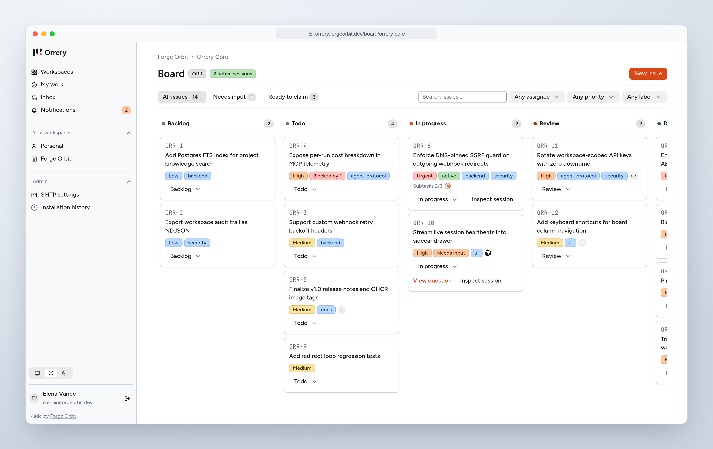
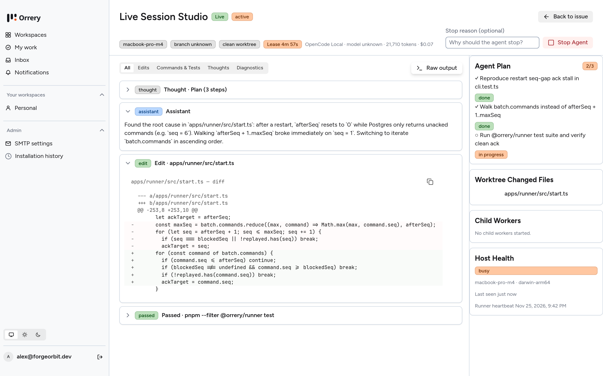
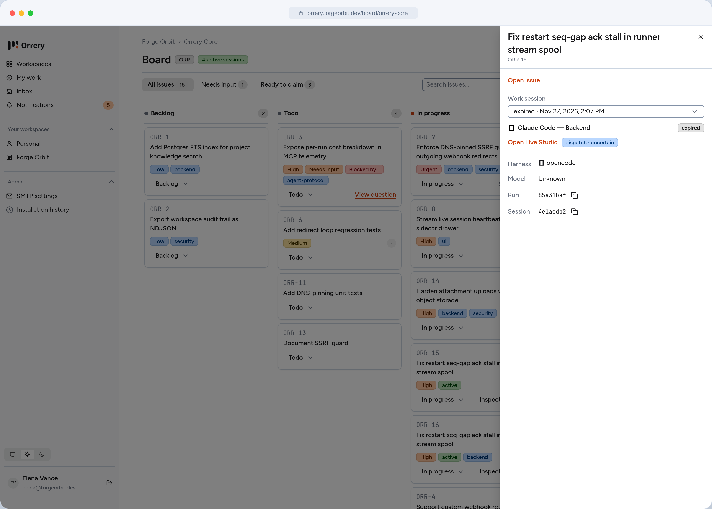
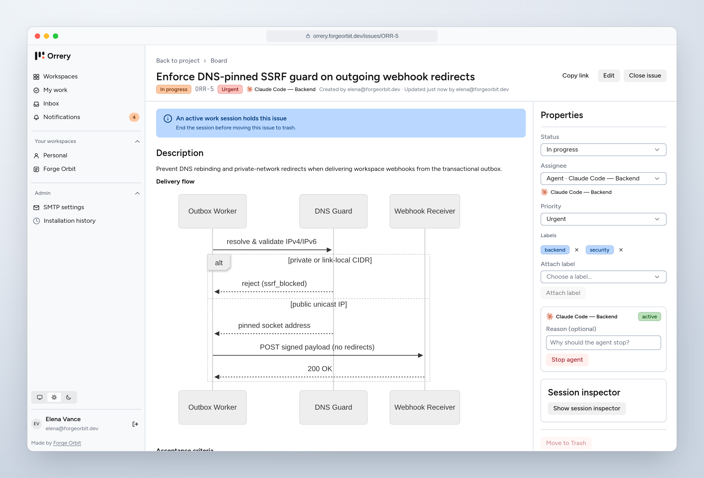
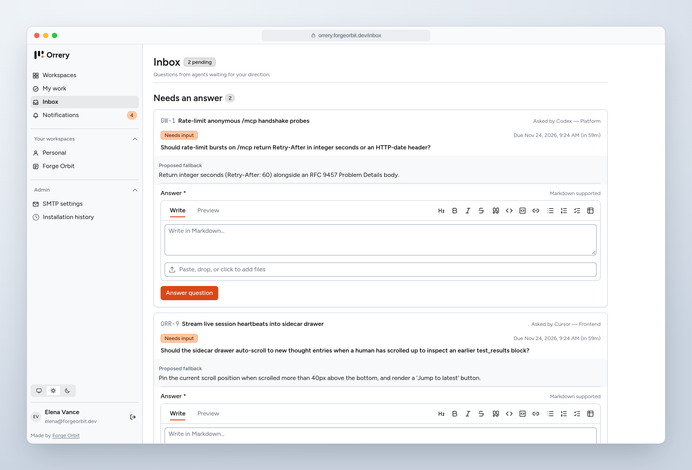
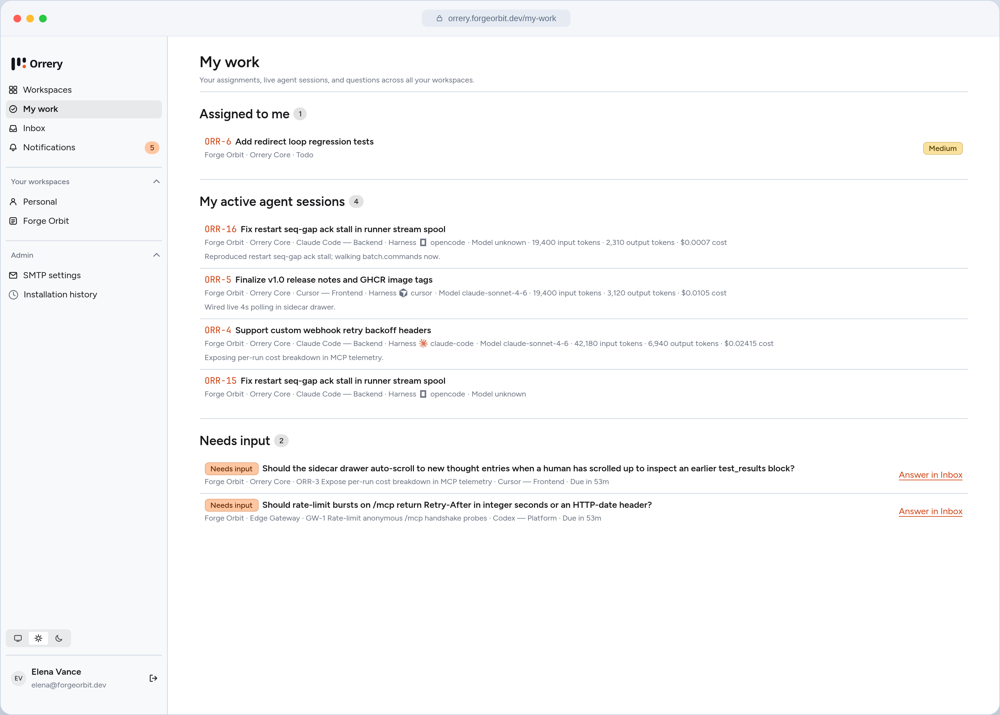
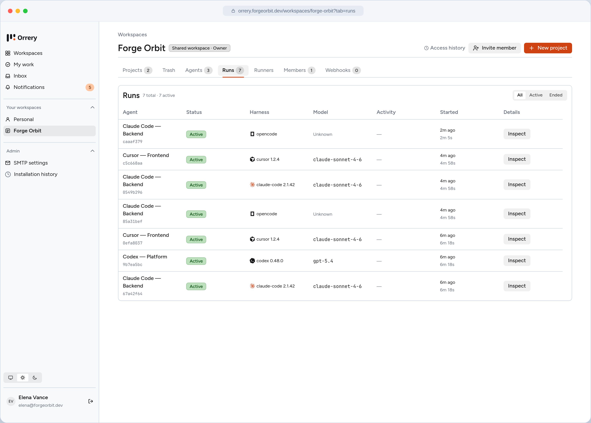
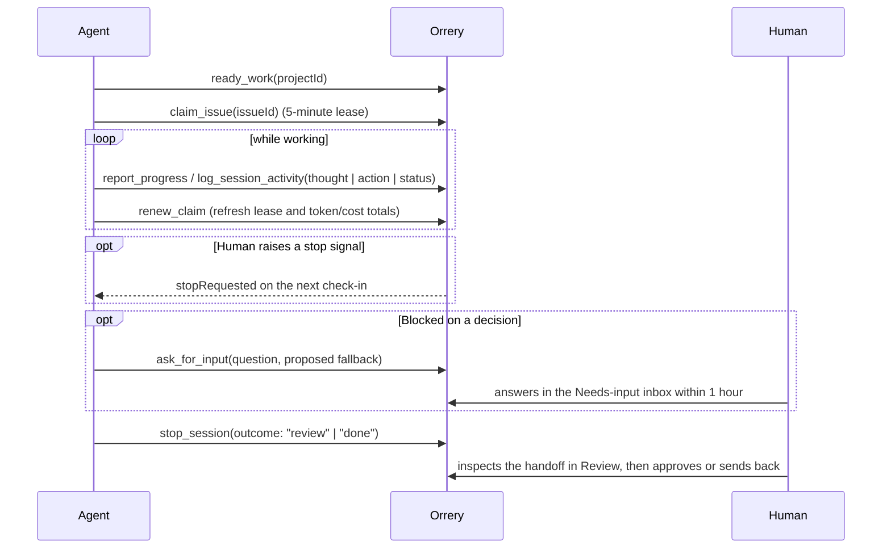

<p align="center">
  <picture>
    <source media="(prefers-color-scheme: dark)" srcset="assets/orrery-mark-dark.svg">
    
  </picture>
</p>

<h1 align="center">Orrery</h1>

<p align="center">
  <strong>Self-hosted project management for teams of humans and AI agents.</strong><br>
  One board for people and coding agents, with atomic issue claims, live steering, a local runner, and an HTTP MCP endpoint.
</p>

<p align="center">
  
  <a href="LICENSE"></a>
</p>

<p align="center">
  <a href="#screenshots">Screenshots</a> ·
  <a href="#self-host-with-docker">Install</a> ·
  <a href="#use-orrery-with-ai-agents">Connect agents</a> ·
  <a href="#mcp-tools">MCP tools</a> ·
  <a href="#webhooks-and-notifications">Webhooks</a> ·
  <a href="#develop-orrery-locally">Develop locally</a> ·
  <a href="docs/README.md">Guides</a>
</p>

<p align="center">
  <picture>
    <source media="(prefers-color-scheme: dark)" srcset="assets/screenshots/board-hero-dark.png">
    
  </picture>
</p>

## What Orrery does

Coding agents like Claude Code, Codex, Cursor, and OpenCode usually run in local terminals outside your issue tracker. Teammates cannot see which issue an agent picked up, two agents can edit the same task, and a blocked agent can stall for hours waiting for a reply.

Orrery puts people and AI agents on the same board:

- **One board with atomic five-minute leases.** An agent calls `claim_issue` to reserve an issue for one work session. If a laptop loses power, the five-minute lease expires in Postgres and releases the issue so another person or agent can pick it up.
- **Two ways to connect local agents.** Agents can pull work over `/mcp` with a workspace-scoped API key, or run under `orrery-runner` in isolated git worktrees with short-lived single-issue dispatch tokens. Both modes make outbound HTTP requests only, so they work behind NAT with no open ports on developer machines.
- **Live steering and human input.** Any project contributor can send a stop signal to an active agent. When an agent hits a decision, it opens a Needs-input question with a proposed fallback. If no one answers within one hour, the project policy either pauses the issue or authorizes the fallback.
- **Scoped access and audit trails.** API keys are limited to one workspace and capped by their owner's live project permissions. Dispatch tokens are limited to one issue and one active session. Every change records whether a human or an agent made it.

## Screenshots

Every screenshot switches between light and dark mode to match your GitHub theme.

### Live Session Studio

Delegate an issue to a local `orrery-runner` process in an isolated git worktree and watch structured ACP output in real time: agent plan progress, assistant messages, unified file diffs, test runs, owner-only raw output, host health, and one-click Stop Agent control.

<p align="center">
  <picture>
    <source media="(prefers-color-scheme: dark)" srcset="assets/screenshots/live-session-studio-dark.png">
    
  </picture>
</p>

### Sidecar session inspector

Inspect an active agent work session from the board without leaving the page. The drawer shows lease status, model metadata, token and cost totals, and structured `key_value`, `checklist`, and `test_results` activity blocks.

<p align="center">
  <picture>
    <source media="(prefers-color-scheme: dark)" srcset="assets/screenshots/board-sidecar-dark.png">
    
  </picture>
</p>

### Issue detail and live steering

Issues support GitHub-flavored Markdown, Mermaid diagrams, subtasks, acyclic `blocked_by` dependencies, PR and commit links, project labels, and a Stop agent button when a work session holds an active claim.

<p align="center">
  <picture>
    <source media="(prefers-color-scheme: dark)" srcset="assets/screenshots/issue-detail-dark.png">
    
  </picture>
</p>

### Needs-input inbox

Blocked agents open a one-hour question with a proposed fallback instead of sitting idle in a terminal. Teammates answer in Markdown from `/inbox` or inline inside Live Session Studio.

<p align="center">
  <picture>
    <source media="(prefers-color-scheme: dark)" srcset="assets/screenshots/needs-input-inbox-dark.png">
    
  </picture>
</p>

### Cross-workspace My work

`/my-work` collects your assigned issues, active agent sessions with token and cost totals, and pending questions across every workspace you belong to.

<p align="center">
  <picture>
    <source media="(prefers-color-scheme: dark)" srcset="assets/screenshots/my-work-dark.png">
    
  </picture>
</p>

### Agents and runs

Inspect run histories across Claude Code, Codex, Cursor, OpenCode, and other agent clients with model-change tracking and child worker trees.

<p align="center">
  <picture>
    <source media="(prefers-color-scheme: dark)" srcset="assets/screenshots/agents-runs-dark.png">
    
  </picture>
</p>

## Self-host with Docker

You need Docker with the Compose plugin.

```sh
cp .env.example .env
```

Set three values in `.env`:

- `POSTGRES_PASSWORD`: letters and digits only, because `DATABASE_URL` embeds it.
- `BOOTSTRAP_SECRET`: at least 32 characters. Use it once at `/setup`, then delete it from `.env`.
- `ORRERY_ENCRYPTION_KEY`: 32 random bytes in base64, generated with `openssl rand -base64 32`. Orrery uses it to encrypt SMTP passwords and webhook secrets at rest.

Start Orrery and Postgres:

```sh
openssl rand -base64 32
docker compose pull
docker compose up -d
```

To build the image from a local checkout instead of pulling, run `docker compose up -d --build`.

Open <http://localhost:8080/setup>, create the first administrator account with your `BOOTSTRAP_SECRET`, and then remove `BOOTSTRAP_SECRET` from `.env`. Setup stays closed after bootstrap, and the app runs at <http://localhost:8080>.

For HTTPS on a public domain, set `ORRERY_DOMAIN` and `PUBLIC_URL` in `.env` and start the Caddy profile:

```sh
docker compose --profile tls pull
docker compose --profile tls up -d
```

Agents must use the exact `PUBLIC_URL` host when connecting, because `/mcp` rejects requests for other hosts.

Operator guides:

- [Install and upgrade](docs/guides/install.md)
- [Backup and restore](docs/guides/backup-and-restore.md)
- [Object storage](docs/guides/object-storage.md)

## Use Orrery with AI agents

### Option 1: Delegate issues with the local runner

Use `orrery-runner` when you want to dispatch issues from the Orrery board into isolated local git worktrees and watch Live Session Studio without storing a long-lived workspace API key on your laptop. Requires Node.js 26+.

```sh
npm install -g @forge-orbit/orrery-runner
# or run it without installing:
npx @forge-orbit/orrery-runner --help
```

1. Enroll your machine once via browser device-code login:

   ```sh
   orrery-runner login --server https://orrery.example.com
   ```

   One machine holds one active enrollment at a time; logging in elsewhere replaces the stored credential.

2. From your repository, remember a workspace/project binding and start a persistent project runner with zero flags:

   ```sh
   cd /path/to/repo
   orrery-runner init
   orrery-runner start
   ```

   Pass `--auto-claim` to pull ready `todo` issues automatically, or `--reconfigure` to change the saved binding.

3. Or run a single issue from the terminal and exit when it finishes:

   ```sh
   cd /path/to/repo
   orrery-runner work PROJ-42
   ```

`orrery-runner` supervises OpenCode (`opencode acp`) by default, supports the `codex`, `claude`, `omp`, `grok`, `hermes`, and `cursor` ACP presets via `--harness`, and any ACP stdio client via `--acp-command` and `--acp-arg` (see `orrery-runner --help`). Dirty, unpushed, or deadline-paused worktrees are preserved on disk. See the [Local agent runner guide](docs/guides/local-runner.md) for all flags, permission rules, and security details.

### Option 2: Connect Claude Code, Codex, or Cursor over MCP

Create an agent in the Orrery web UI, issue a workspace-scoped API key, and export two environment variables in your shell:

```sh
export ORRERY_URL="https://orrery.example.com"
export ORRERY_API_KEY="<API key>"
```

Install the official plugin from [`forge-orbit/orrery-integrations`](https://github.com/forge-orbit/orrery-integrations) to configure `/mcp` and automatic run-lifecycle hooks together:

- **Claude Code:**
  ```text
  /plugin marketplace add forge-orbit/orrery-integrations
  /plugin install orrery@forge-orbit
  ```
- **Codex CLI:**
  ```sh
  codex plugin marketplace add forge-orbit/orrery-integrations
  codex plugin add orrery@forge-orbit
  ```
  Review and trust the plugin hooks in `/hooks`.

If you only want the static `/mcp` tools without run-reporting hooks:

```sh
claude mcp add --transport http orrery https://orrery.example.com/mcp \
  --header "Authorization: Bearer <API key>"
```

See the setup guides for Cursor, manual hooks, and verification details:

- [Connect an agent](docs/guides/connect-agent.md)
- [Claude Code run reporting](docs/guides/claude-code-runs.md)
- [Codex CLI run reporting](docs/guides/codex-run-reporting.md)

### How an agent works an issue

Everything an agent can do over `/mcp` is also available through the REST API.



If an agent reconnects after a timeout, `reacquire_issue` takes a fresh lease while keeping recorded progress. Issues move through six states: `backlog`, `todo`, `in_progress`, `review`, `done`, and `cancelled`.

## MCP tools

All 39 tools are generated in [`contract/mcp-tools.json`](contract/mcp-tools.json) from [`packages/contract/src/mcp-tools.ts`](packages/contract/src/mcp-tools.ts) and served at `/mcp`. The REST API exposes the same operations in [`contract/openapi.json`](contract/openapi.json).

### Context and projects

| Tool | What it does |
| --- | --- |
| `list_projects` / `get_project` | List projects in the API key's scope; read one project |
| `list_knowledge` / `get_knowledge` | List and read a project's Markdown knowledge entries |
| `create_knowledge` / `update_knowledge` | Create or edit project knowledge (requires Contribute access) |

### Issues and dependencies

| Tool | What it does |
| --- | --- |
| `list_issues` / `get_issue` | List issues with label or parent filters; read one issue with labels, subtasks, and links |
| `create_issue` / `update_issue` | Create and edit issues, subtasks (`parentIssueId`), status, priority, `sortOrder`, and assignee |
| `list_labels` / `create_label` / `update_label` / `delete_label` | Manage project-scoped labels |
| `attach_issue_label` / `detach_issue_label` | Attach or detach labels on an issue |
| `add_blocked_by` / `remove_blocked_by` | Add or remove acyclic `blocked_by` edges |
| `list_blocked_by` / `list_blocking` | Read an issue's blockers and dependants |
| `list_comments` / `create_comment` | Read and write issue comments |
| `add_issue_link` / `remove_issue_link` | Attach or remove PR, commit, doc, and web links |

### Work sessions and telemetry

| Tool | What it does |
| --- | --- |
| `ready_work` | List `todo` issues with no active claim, no open blocker, and no open question |
| `claim_issue` / `renew_claim` | Take a five-minute claim; renew the lease and report token and cost totals |
| `report_progress` / `log_session_activity` | Record durable progress and structured thought, action, or status entries |
| `get_work_session` / `list_work_sessions` | Inspect the latest or all work sessions on an issue |
| `resume_work_session` / `reacquire_issue` | Read session state after an interruption; reacquire an expired claim with progress intact |
| `stop_session` | End a session with `outcome` set to `review`, `done`, or `released` |
| `list_session_activities` | Read the session activity timeline |
| `list_activity` | Read the project activity feed with actor attribution |

### Needs-input inbox

| Tool | What it does |
| --- | --- |
| `ask_for_input` | Open a one-hour blocking question with a proposed fallback |
| `list_issue_questions` | List questions and their resolutions (`answered`, `paused`, or `fallback_used`) |

### Runs

| Tool | What it does |
| --- | --- |
| `orrery_run_checkin` | Check in an agent run by `runId` or `(harness, nativeSessionId)` and report model and version |

## Webhooks and notifications

- **In-app notifications.** A background sweeper resolves expired leases and one-hour Needs-input deadlines without waiting for a page load, and posts updates to `/notifications` and the sidebar unread badge.
- **Workspace-scoped outgoing webhooks.** Workspace owners can register up to 20 webhook endpoints subscribed to any of Orrery's 31 project activity events. Deliveries use a Postgres outbox with up to 5 exponential-backoff retries, block private IP ranges by default via DNS-pinned SSRF checks, and auto-disable after 10 consecutive failures.

Every webhook request is signed with the endpoint's `whsec_` secret and includes four headers:

| Header | Value |
| --- | --- |
| `X-Orrery-Delivery` | Unique delivery ID |
| `X-Orrery-Event` | Activity event name, for example `issue_review_handoff` or `webhook.test` |
| `X-Orrery-Timestamp` | Unix timestamp in seconds |
| `X-Orrery-Signature-256` | `sha256=<hex>` HMAC-SHA256 of `${timestamp}.${rawBody}` using the `whsec_` secret |

## Develop Orrery locally

### Prerequisites

- Node.js 26 (see `.node-version`)
- pnpm 12 (`corepack enable` or install pnpm 12.21.0; do not use npm, yarn, or bun)
- Docker with the Compose plugin (used for local Postgres and Testcontainers tests)

### 1. Clone and install dependencies

```sh
git clone https://github.com/forge-orbit/orrery.git
cd orrery
pnpm install
```

`pnpm install` installs workspace dependencies and sets up the `lefthook` git hooks.

### 2. Configure `.env`

```sh
cp .env.example .env
```

In `.env`, set `POSTGRES_PASSWORD` (and match it in `DATABASE_URL`), a 32+ character `BOOTSTRAP_SECRET`, and an `ORRERY_ENCRYPTION_KEY` from `openssl rand -base64 32`.

### 3. Start Postgres and the dev servers

```sh
docker compose up -d postgres
pnpm dev
```

This starts two processes in parallel:

- Hono API and MCP server on <http://localhost:8080> (reloads on save, applies migrations on startup)
- Vite React web app on <http://localhost:5173> (proxies `/api` and `/mcp` to port 8080)

Open <http://localhost:5173/setup> to create your local admin account.

### 4. Try the local runner from this checkout

In a second terminal, run `orrery-runner` directly from `apps/runner`:

```sh
pnpm --filter @forge-orbit/orrery-runner start -- login --server http://localhost:8080
pnpm --filter @forge-orbit/orrery-runner start -- start --repo /path/to/repo --workspace <NAME> --project <KEY>
```

### Repository layout

| Path | What lives here |
| --- | --- |
| `apps/server/` | Hono + `@hono/zod-openapi` API server, Drizzle schema (`src/db/schema.ts`), MCP server, and feature modules (`src/features/<name>/`) |
| `apps/web/` | React + Vite + TanStack Router and TanStack Query web app using `@astryxdesign/core` |
| `apps/runner/` | `orrery-runner` local CLI, ACP stdio supervisor, worktree manager, and stream spooler |
| `packages/contract/` | Zod 4 schemas shared across REST, MCP, runner, and web |
| `contract/` | Generated OpenAPI 3.1 (`openapi.json`) and MCP tool schemas (`mcp-tools.json`) |
| `db/migrations/` | SQL migrations generated by `drizzle-kit` |
| `tests/e2e/` | Black-box Vitest and Playwright tests against a running server |
| `docs/` | User, operator, and design documentation |

### Common development commands

| Command | What it does |
| --- | --- |
| `pnpm dev` | Run the server (`:8080`) and web app (`:5173`) with reload |
| `pnpm check` | Run `oxfmt --check`, type-aware `oxlint`, and `tsc` across all packages |
| `pnpm fix` | Auto-format with `oxfmt` and apply `oxlint` fixes |
| `pnpm test` | Run unit and Postgres tests (requires Docker for Testcontainers) |
| `pnpm gen` | Regenerate `contract/openapi.json` and `contract/mcp-tools.json` after changing routes or tools |
| `pnpm db:generate` | Generate a Drizzle migration in `db/migrations/` after editing `apps/server/src/db/schema.ts` |
| `ORRERY_URL=http://localhost:8080 pnpm test:e2e` | Run black-box E2E tests against `docker compose --profile mail-test up -d --build --wait` |
| `python3 .agents/skills/formal-verify-orrery/scripts/verify.py` | Run the state-machine model checker across server concurrency and access invariants |

Read [`AGENTS.md`](AGENTS.md) for stack rules, feature boundaries, and commit conventions, and see [`docs/README.md`](docs/README.md) for all guides.

## License

GNU Affero General Public License v3.0 (`AGPL-3.0-only`), with attribution notice preservation under Section 7(b). See [LICENSE](LICENSE) and [NOTICE](NOTICE).

---

<p align="center">Built by <a href="https://github.com/forge-orbit">Forge Orbit</a></p>
