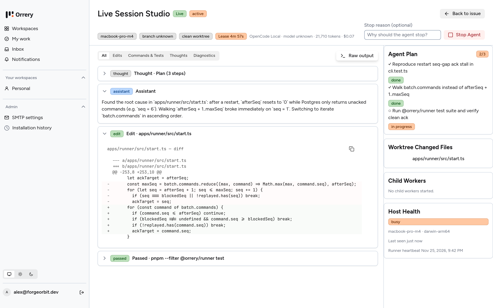

# Local agent runner

`orrery-runner` lets you delegate Orrery issues directly to a local ACP-compatible coding agent
(such as OpenCode) on your own machine — behind NAT, with no inbound ports and no long-lived
workspace API key stored on disk.

Each accepted dispatch runs in an isolated `git worktree` with a short-lived, single-issue
`Dispatch token` (`orr_dt_...`), streams structured ACP events to **Live Session Studio**, and
parks cleanly when the agent asks a **Needs input** question so you can answer inline and resume
the same local session.

> Prefer to drive your agent directly from your terminal (Claude Code, Codex CLI, or Cursor) without
> board-initiated delegation? See [Connect an agent](./connect-agent.md).

## Prerequisites

- **Node.js 26+** (matching `.node-version`).
- A local **git** checkout of the repository for the project you want to work on.
- An **ACP (Agent Client Protocol)** stdio harness installed on your machine. By default,
  `orrery-runner` spawns `opencode acp`; you can point it at any ACP-compatible harness with
  `--acp-command` / `--acp-arg` (or `ORRERY_ACP_COMMAND` / `ORRERY_ACP_ARGS`).
- At least one **Agent** owned by your Orrery account, and **Contribute** (or **Manage**) access to
  the target project.

From this repository, run the CLI with:

```sh
pnpm --filter @orrery/runner start -- <command> [options]
```

(When installed as a package binary, invoke `orrery-runner <command> [options]` directly.)

## 1. Enroll your machine (`login`)

Enroll your machine once as an installation-wide **Runner host** using browser device-code login:

```sh
orrery-runner login --server https://orrery.example.com
```

1. The CLI prints a verification URL (`/device?code=XXXX-XXXX`) and a one-time user code.
2. Open the URL in a signed-in Orrery browser session and approve the host.
3. The CLI exchanges the verifier-bound device code for a host credential (`orr_rh_...`) and saves
   it with `0600` permissions at `~/.config/orrery/runner-credential.json` (override the directory
   with `ORRERY_RUNNER_CONFIG_DIR`).

Verify the stored enrollment at any time:

```sh
orrery-runner status
```

No long-lived workspace API key (`orr_ak_...`) is written to your machine. Every workspace and
project check runs live against Postgres on each request.

## 2. Run modes

### Persistent project runner (`start`)

Bind a Runner process to one workspace, one project, and one local git checkout:

```sh
orrery-runner start \
  --server https://orrery.example.com \
  --workspace <WORKSPACE_ID> \
  --project <PROJECT_ID> \
  --repo /path/to/repo
```

What `start` does:

- Registers (or resumes) a project-bound `Runner` identified by an opaque SHA-256 `repoFingerprint`
  of your checkout — your raw local filesystem path never leaves your machine.
- Sends heartbeats (default every 5 s) so Orrery derives presence (`Online`, `Busy`, `Offline`) in
  database time.
- Long-polls the transactional command outbox (`/api/runners/:runnerId/commands`) for `dispatch`,
  `cancel`, and `input_resolved` commands.
- Runs up to `--concurrency N` (default `1`, max `64`) simultaneous dispatches, each in its own
  isolated `git worktree`.

### Opt-in autonomous pickup (`--auto-claim`)

By default, a persistent runner waits for manual delegation from the Orrery UI. Pass `--auto-claim`
to also pull ready `todo` issues automatically:

```sh
orrery-runner start \
  --server https://orrery.example.com \
  --workspace <WORKSPACE_ID> \
  --project <PROJECT_ID> \
  --auto-claim \
  --auto-claim-filter assignedToMe
```

`--auto-claim-filter` controls which ready issues are eligible:

| Value | Picks up |
| --- | --- |
| `assignedToMe` *(default)* | Ready `todo` issues assigned to this Runner's Agent |
| `unassigned` | Unassigned ready `todo` issues |
| `all` | Either unassigned or assigned to this Runner's Agent |

Issues with an open blocker, a live Work session, an active/pending/uncertain Dispatch, or
`Needs input` are never claimed.

### One-shot issue mode (`work`)

Run a single issue end-to-end from the command line without leaving a background runner process
open:

```sh
orrery-runner work PROJ-42 --server https://orrery.example.com --repo /path/to/repo
```

`work` accepts an issue UUID, a `KEY-N` identifier (such as `PROJ-42`), or a full Orrery issue URL.
If a `KEY-N` identifier matches projects in more than one workspace you belong to, Orrery refuses
to guess and lists the matching workspaces — pass `--workspace <ID|name|slug>` to disambiguate.

`work` registers an ephemeral single-use Runner, dispatches and supervises the issue (including
heartbeats, Live Session Studio streaming, Needs Input resume, and teammate Stop), marks the
ephemeral Runner offline on exit or `Ctrl-C`, and exits `0` only when the session completes
normally.

## 3. Delegating, watching live, and steering

### Manual dispatch & Runner Fleet

- View connected machines and project-bound runners in the workspace's **Runners** fleet view.
  Presence (`Online` / `Busy` / `Offline`) is derived by Postgres from `last_seen_at` and active
  slots.
- On any ready `todo` issue, the owner of an online Runner host can click **Delegate to Runner**
  (and optionally choose another of their own Agents compatible with `issues.assignee`).
- **Owner-only dispatch:** Teammates with project access can see your Runner in the fleet, but only
  you can dispatch work to your machine. Any project contributor or manager can still click
  **Stop** on an active session to enqueue an emergency `cancel`.

### Live Session Studio

Open **Live Session Studio** from an active or completed delegated session to watch:



- Structured ACP events (tool calls, plans, file diffs, child workers, and typed diagnostics such
  as `acp_not_installed`, `acp_crashed`, `auth_expired`, `usage_limit`, `provider_overload`,
  `permission_denied`, and `runner_disconnected`).
- **Owner-only raw output:** Raw stderr/stdout chunks are tagged `owner_only` on ingest and
  filtered server-side for every viewer other than the Runner host owner (including system
  administrators).
- **Offline replay:** While active, chunks live in Postgres (`work_session_stream_chunks`); when
  the session ends, non-empty streams roll up into a single JSONL blob in
  [Object storage](./object-storage.md) (`stored_objects`) so you can replay the session later.

### Inline Needs Input round-trip

When the local ACP agent calls `ask_for_input` and finishes its turn with an open question:

1. `orrery-runner` **parks** the live ACP process and its worktree while continuing to renew the
   five-minute Work session lease.
2. Answer the question inline in **Live Session Studio** (or from `/inbox`).
3. Orrery commits the answer and enqueues an `input_resolved` outbox command in the same
   transaction; `orrery-runner` wakes the parked ACP session on the same worktree with your answer.
4. If the one-hour deadline expires:
   - Under `fallback_used`, Orrery authorizes the proposed fallback and enqueues `input_resolved`
     to resume automatically.
   - Under `require_human`, Orrery releases the claim and enqueues `cancel`; `orrery-runner` stops
     the ACP process and **preserves the worktree** so you can re-dispatch explicitly after
     answering.

### Disconnected & uncertain attempts

If a Runner misses heartbeats during an active dispatch (for example, your laptop sleeps), Orrery
marks the attempt `uncertain` instead of auto-rerunning it:

- If the Runner reconnects while the Work session lease is still live, it replays any spooled
  chunks from `<repo>/.orrery/runs/<dispatchAttemptId>/stream.jsonl` and resumes seamlessly.
- If the lease expired or the attempt is no longer running locally, the dispatch stays `uncertain`
  until a human explicitly resolves it in the UI before re-dispatching.

## 4. Worktrees, permissions, and security

### Isolated git worktrees

- Each dispatch creates a fresh branch `orrery/<issue-key>-<hash>` and worktree under
  `<parent-of-repo>/.orrery-worktrees` (override with `--worktree-root` or `ORRERY_WORKTREE_ROOT`).
- **No silent data loss:** Only clean, fully pushed worktrees are pruned automatically on exit.
  Dirty worktrees, unpushed commits, and `require_human` deadline pauses are always preserved on
  disk and reported in the session activity trail.
- The local stream spool is stored under `<repo>/.orrery/runs/<dispatchAttemptId>/stream.jsonl` in
  the main checkout so a preserved worktree never hides live Studio chunks.

### Scoped Dispatch tokens & environment hardening

- Accepting a dispatch mints a short-lived `Dispatch token` (`orr_dt_...`) fenced to that single
  `(host, runner, dispatchAttempt, agent, workspace, project, issue, run, workSession)`.
- `claim_issue`, `renew_claim`, and any cross-issue or cross-project calls are refused by `/mcp`
  and REST for Dispatch tokens.
- Before spawning the ACP child process, `orrery-runner` strips host-level `ORRERY_*` environment
  variables so the agent only sees the ephemeral `/mcp` configuration and its scoped Dispatch token.

### Local ACP permission policy

`orrery-runner` evaluates ACP `session/request_permission` and `fs/*` requests locally:

- Confines file paths and shell redirects to the slot's real worktree path (resolving symlinks and
  rejecting `..` escapes).
- Allows only non-destructive commands on the local allowlist and rejects shell metacharacters,
  `sudo`, `rm -rf`, `git push --force`, `git reset --hard`, and similar destructive forms.
- Selects only one-shot `allow_once` options — never standing `allow_always` grants.

> **Not an OS sandbox.** This permission policy is an application-layer gate, not an OS or process
> sandbox. Any allowed command (such as `pnpm`, `git`, or `make`) runs with your OS user's
> privileges. If you need hard OS confinement, run `orrery-runner` inside a container, VM, or OS
> sandbox wrapper (`bwrap`, `sandbox-exec`).

### Revocation and offboarding

- **Revoke a Runner host** in the Orrery UI to revoke the host credential and every Runner
  registered under it.
- **Workspace member removal** revokes only that member's Runners bound to the removed workspace.
- **Human deactivation** revokes all of that human's Runner hosts installation-wide.
- In all cases, Orrery revokes active Dispatch tokens and enqueues `cancel` commands; on `401` or
  `cancel`, `orrery-runner` terminates its local ACP process groups immediately.

## 5. CLI & environment reference

| Flag | Env var | Default | Used by | Description |
| --- | --- | --- | --- | --- |
| `--server URL` | `ORRERY_URL` | `http://localhost:8080` | all | Orrery base URL (`PUBLIC_URL`) |
| `--host-name NAME` | — | OS hostname | `login` | Display name for this machine |
| `--platform NAME` | — | `<platform>-<arch>` | `login` | Platform label shown in Runner Fleet |
| `--workspace ID` | — | — | `start`, `work` | Workspace ID (`start`) or ID/name/slug to disambiguate a key (`work`) |
| `--project ID` | — | — | `start` | Project ID to bind the Runner to |
| `--agent ID` | — | owner's first Agent | `start`, `work` | Default Agent ID for dispatches |
| `--name NAME` | — | host display name | `start` | Runner display name |
| `--capability NAME` | — | `[]` | `start` | Repeatable declared capability (first entry sets default Run harness label) |
| `--concurrency N` | — | `1` | `start` | Max concurrent local slots (`1`–`64`) |
| `--repo PATH` | — | current directory | `start`, `work` | Local git checkout path |
| `--heartbeat-ms N` | — | `5000` | `start` | Heartbeat interval in ms (min `10`) |
| `--auto-claim` | — | `false` | `start` | Opt in to autonomous ready-work pickup |
| `--auto-claim-filter` | — | `assignedToMe` | `start` | `assignedToMe`, `unassigned`, or `all` |
| `--auto-claim-poll-ms N` | — | `1000` | `start` | Auto-claim polling interval in ms |
| `--acp-command NAME` | `ORRERY_ACP_COMMAND` | `opencode` | `start`, `work` | Local ACP stdio harness executable |
| `--acp-arg ARG` | `ORRERY_ACP_ARGS` (JSON array) | `["acp"]` | `start`, `work` | Repeatable ACP harness argument |
| `--lease-renew-ms N` | `ORRERY_LEASE_RENEW_MS` | `60000` | `start`, `work` | Work-session lease renewal interval in ms |
| `--cancel-grace-ms N` | `ORRERY_CANCEL_GRACE_MS` | `2000` | `start`, `work` | `SIGTERM` → `SIGKILL` grace period in ms |
| `--worktree-root PATH` | `ORRERY_WORKTREE_ROOT` | `../.orrery-worktrees` | `start`, `work` | Parent directory for per-slot git worktrees |
| — | `ORRERY_RUNNER_CONFIG_DIR` | `~/.config/orrery` | all | Directory storing `runner-credential.json` (`0600`) |

For the full architectural specification, lock order, and rejected alternatives, see
[ADR-0010](../adr/0010-local-agent-runner-and-live-streaming.md).
